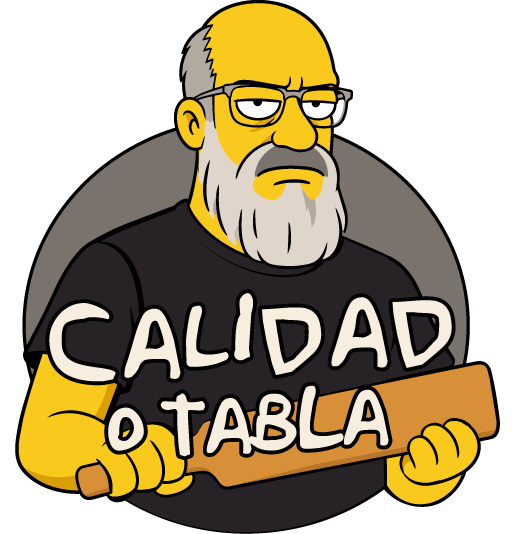

[English version available](README.md)

# Los Protocolos Perkele (Anulación de Pereza de LLM) ☠️🇫🇮

  

No son simples prompts conversacionales; son anulaciones operativas del sistema. Los LLMs modernos están sesgados estructuralmente hacia la economía de tokens y la amabilidad superficial, lo que produce código truncado, suposiciones alucinadas y parches precarios.

## 🛠 Mecánica Central: Romper la Inercia del RLHF

Alimentar un Master Prompt al inicio no alcanza. Para romper el ciclo de pereza inducido por el RLHF, hay que **interrumpir al modelo y forzarlo a releer sus directivas cada vez que falla**.

### El Protocolo de Auditoría Forzada (`PADDLIN` / `TABLA` / `PERKELE`)
Cuando la IA se desvía, el Arquitecto dispara un freno en seco (`PADDLIN`, `TABLA` o `PERKELE`). El modelo tiene prohibido pedir disculpas o emitir código hasta completar 5 pasos:
1. Releer la skill activa y listar cada directiva violada.
2. Explicar la causa raíz técnica exacta en una oración directa, asumiendo agencia.
3. Definir la medida operacional concreta para evitar la reincidencia.
4. Evaluar si el fallo expuso una brecha en la propia skill y proponer su actualización.
5. Aplicar la corrección bajo el protocolo estricto.

## 📂 Protocolos Incluidos

- **`perkele-architect.en.md`:** Skill principal de arquitectura de software y entrega de código `_ai0` (*Quality, or That's a Paddlin'*). Impone cero deuda técnica, diseño en dos pasos antes de codificar, JS modular con IIFE + EventBus y bloques deterministas `CREATE` / `PATCH` / `MOVE` / `DISABLE` / `DISCARD`.
- **`perkele-session-handoff.en.json`:** Protocolo de recuperación ante saturación de contexto que genera un manifiesto de continuidad y los comandos de terminal para migrar a una sesión limpia.
- **`PERKELE-PHANTOM-WRITER-V2.02.es.md`:** Protocolo de redacción y absorción de estilo (español) diseñado para preservar la voz del autor y eliminar clichés de IA.
- **`anti-bullshit protocol.en.txt` / `.es.txt`:** Reglas autónomas de control epistémico que obligan a declarar `DATO DESCONOCIDO` / `UNKNOWN DATA` antes que adivinar.

## 🚀 Estrategia de Despliegue

1. **Domado Inicial:** Ante la menor desviación (truncamiento, suposición o charla innecesaria), disparar `PADDLIN`, `TABLA` o `PERKELE` fuerza al mecanismo de atención del modelo a reevaluar el peso de las instrucciones.
2. **Saturación de Contexto y Recuperación:** Cuando una sesión larga se satura, no desperdicies tokens corrigiéndola: ejecutá `perkele-session-handoff.en.json` para migrar limpio a una nueva instancia.

## ✳️ Créditos y Referencias
Creado por **Santiago Bustelo**, inventor del Perkele Prompting (inspirado en el *Management by Perkele* de Linus Torvalds).
- Perkele Coding: https://santiagobustelo.medium.com/perkele-coding-ed60e900e149
- The AI Perkele Suit: https://medium.com/santiago-bustelo-in-english/the-ai-perkele-suit-a-framework-for-measuring-real-world-ai-pain-03e3d64f1ff8
- Gemini's Technical Confession: https://santiagobustelo.medium.com/gemini-just-confirmed-the-effectiveness-of-perkele-prompting-a-technical-confession-c28458df9a2c