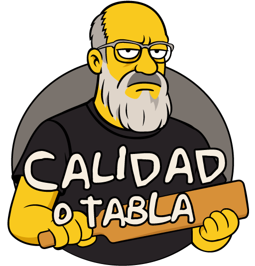

[English version available](README.md)

# AI-DevTools y Librería j0 🛠️🤖

<p align="center">
  
</p>

Protocolos para mantener a las IA cortitas y la deuda técnica bajo control. Herramientas para desarrollar con IA sin quedar atado a servicios, plataformas ni infraestructura costosa.

-   **Modelos accesibles:** desarrollo agéntico utilizando modelos de chat, incluso gratuitos o económicos, en lugar de depender de servicios especializados de programación.
-   **Sin Vercel Tax:** proyectos que pueden desarrollarse, compilarse y desplegarse en infraestructura convencional, desde hosting estático hasta PHP compartido.

---

## 🛠 Contenido del Repositorio

### 1. `ai0/` — Suite Local de Desarrollo IA y Primitivos `j0`
Herramientas en PHP 8.2+ y Vanilla JS (corre en macOS Valet, Apache, Nginx o servidor embebido de PHP sin dependencias externas):

- **`dumper` (`ai0dump.php`):** Árbol interactivo con checkboxes, categorías regex de exclusión, filtro **Show excluded only**, detección de binarios y generación de contexto lista para copiar o descargar.
- **`patcher` (`ai0patch.php`):** Aplicador atómico multi-archivo con soporte para `CREATE`, `PATCH` (anclaje `1-Line First`), `MOVE`, `DISABLE` (`_`) y `DISCARD` (`_🗑️`), respaldos automáticos `_📦` y validación de sintaxis `php -l`.
- **`restore` (`ai0restore.php`):** Detecta lotes de respaldo `_📦` con marca de tiempo en el proyecto y restaura versiones previas en un clic.
- **`purge` (`ai0purge.php`):** Libera espacio en disco preseleccionando ítems descartados (`_🗑️`, `__`) y respaldos (`_📦`), manteniendo protegidos por defecto los archivos deshabilitados por humanos (`_*`).
- **Suite Modular `j0/` en 3 Capas (`core/`, `tooling/`, `src/`):**
  - `j0/core/`: Micro-kernel unificado `01-j0kernel.js` (EventBus + Service Registry + Logger pasivo) y primitivos PHP base (`closest`, `config`, `prefix`, `scan`).
  - `j0/tooling/`: Utilidades composables de build, escritura atómica, backups, tags de assets y caché HTML estática (stub `ai0build.php`).
  - `j0/src/`: Módulos verticales políglotas (`vfs/` para KV + cookie SSR + IndexedDB blobs/documentos, y extensión de capacidad `vfs--remote/` para sincronización cloud con `j0auth`).

#### Inicio Rápido (`ai0`)
Copiá o creá un symlink de `ai0/` en la raíz de cualquier proyecto como `_ai0` (excluido nativamente por los scanners y builders de `ai0` y `j0`; agregá `_*` al `.gitignore` y a las exclusiones FTP de tu proyecto):

```bash
cd /ruta/a/tu-proyecto
ln -s /ruta/a/AI-DevTools/ai0 _ai0
echo "_*" >> .gitignore
```

Abrí `http://tu-proyecto.test/_ai0/` o copiá cualquier stub portable desde `ai0/stubs/` en cualquier subdirectorio: `ai0dump.php`, `ai0restore.php` y `ai0purge.php` acotan el escaneo a esa subcarpeta, `ai0build.php` compila bundles CSS/JS locales en ese directorio y `ai0patch.php` aplica bloques `_ai0` con rutas relativas a la raíz del proyecto.

---

### 2. `AI-PerkeleProtocols/` — Protocolos de Control Conductual y Epistémico ☠️🇫🇮
Prompts de sistema y skills creados por **Santiago Bustelo** (inspirados en el *Management by Perkele* de Linus Torvalds) para anular los atajos de ahorro de tokens del RLHF:

- **`ai0-perkele-architect.en.md`:** Skill principal de arquitectura y entrega de código (*Quality, or That's a Paddlin'*).
- **`perkele-session-handoff.en.json`:** Generador determinista de continuidad para ventanas de contexto saturadas.
- **`PERKELE-PHANTOM-WRITER-V2.02.es.md`:** Protocolo de redacción y absorción de estilo (español).
- **`anti-bullshit protocol.en.txt` / `.es.txt`:** Reglas de control epistémico contra alucinaciones.

---

### 3. `docs/` — Especificaciones Técnicas (en inglés)
- [`docs/j0 & ai0 architecture.md`](docs/j0%20%26%20ai0%20architecture.md) — Arquitectura del sistema, cascada de 4 niveles `[_]ai0config` y separación `.php` vs. `.json`.
- [`docs/j0-naming-conventions.md`](docs/j0-naming-conventions.md) — Taxonomía de prefijos (`_`, `__`, `_🗑️` *Discard*, `_📦`) y convenciones pseudo-BEM.
- [`docs/j0-primitives.md`](docs/j0-primitives.md) — Referencia de API para módulos PHP y JS de `j0`.
- [`docs/j0-tutorial.md`](docs/j0-tutorial.md) — Guía paso a paso de adopción progresiva.
- [`docs/ai0 CHANGELOG.md`](docs/ai0%20CHANGELOG.md) — Historial completo de versiones.

---

## ✳️ Créditos y Artículos
Creado por **Santiago Bustelo** (https://www.bustelo.com.ar/).
- Perkele Coding: https://santiagobustelo.medium.com/perkele-coding-ed60e900e149
- The AI Perkele Suit: https://medium.com/santiago-bustelo-in-english/the-ai-perkele-suit-a-framework-for-measuring-real-world-ai-pain-03e3d64f1ff8
- Gemini's Technical Confession: https://santiagobustelo.medium.com/gemini-just-confirmed-the-effectiveness-of-perkele-prompting-a-technical-confession-c28458df9a2c

## ⚖️ Licencia
[Licencia Dual Apache 2.0 / CC BY 4.0](LICENSE)